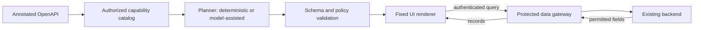

# Every new application should be usable through an AI chat, without making users learn a new frontend.

**Adaptive UI Gateway (AUG)** — an experimental bridge between existing backends and AI chat frontends.

[](https://github.com/CELOTTOA/adaptive-ui-gateway/actions/workflows/ci.yml)

AUG is an experimental reference implementation for developers exploring generative UI,
backend integration and data access boundaries. It turns an explicitly annotated OpenAPI
operation into a validated, declarative search interface. A trusted renderer displays the
plan; an authenticated gateway retrieves the permitted records through a separate channel.

**Status: v0.1 experimental.** The working slice is read-only search and tables. This is an
invitation to examine the design, reproduce the results and challenge the assumptions.
It is not a production identity system or a universal backend connector.

## Why AUG exists

AUG began with a reflection on how people access information. Search engines such as
Google became a familiar place to look for answers. The hypothesis is that AI conversations,
with systems such as ChatGPT and Claude, could also become a common starting point for
using software. A user could describe an objective, discover the relevant application
capabilities and work through the task with an interface composed for that moment.

Today, using several applications often means learning several frontends: their navigation,
terminology and workflows. The question behind AUG is whether a familiar AI chat could
provide a common interaction layer, with tables, selections and other controls appearing
when the task needs them.

In that vision, existing applications continue to provide their domain logic, calculations,
business rules and authorization. They expose capabilities that an AI-facing layer can
help users access. For software developers, this could offer an additional way to make
their applications useful through the conversational environments people already use.

The long-term question is: **can someone use an application they have never learned by
describing what they want to accomplish in an AI chat?** A further step would be completing
a task across several applications through that same interaction layer. Specialized
interfaces would still have a role in intensive work and tasks requiring precise control.

This is a direction to investigate, not a forecast established by the prototype.
Cross-application orchestration and general intent-driven workflows are not implemented.

## From vision to a first experiment

The first candidate passed CI on Windows and Linux with Node 22 and 24. See
[the publication record](docs/publication.md) for commands, evidence and exclusions.

The current experiment addresses one part of that vision: can an AI model help design
useful interfaces from authorized capability metadata, while record values are fetched
only when the user interacts with the resulting interface?

AUG implements that separation, including a deterministic planner for a reproducible
baseline. Whether a model improves usability enough to justify its cost and latency remains
an open evaluation question. We welcome comparisons with hand-built and deterministic UI.



The optional model receives intent, authorized field names and operation metadata. It does
not choose backend URLs, credentials or binding policies. AUG does not send retrieved
records to the planner or through its MCP tool results. **This is a property of AUG's own
channels, not a guarantee against a compromised host, screen capture or user disclosure.**

## Try it in five minutes

Requirements: Git, Node.js **22.14+ on the 22.x line, or 24.x**, and npm. No model account,
Docker, certificate installation or external backend is required for the default demo.

```sh
git clone https://github.com/CELOTTOA/adaptive-ui-gateway.git
cd adaptive-ui-gateway
npm ci
npm test
npm run demo
```

Open **http://127.0.0.1:4000**, enter `demo-analyst-token`, and select
**Create search interface**. Search for `CANARY`: the synthetic tenant-a customer appears
with the approved fields. Search for `Torino`, or leave the search empty.

The sample backend listens on loopback port 4100; the gateway uses port 4000. Stop with
Ctrl+C. The credentials and records are deliberately public demo fixtures.
The default planner is deterministic unless a `GROK_API_KEY` is present in the environment
or an optional local `.envlocal` file. A clean checkout needs neither.

For an HTTP-only walkthrough and model configuration, see [Getting started](docs/getting-started.md).
For the actual renderer and request path, see [the walkthrough](docs/demo-walkthrough.md).

## What works today

| Area | Implemented scope |
|---|---|
| Discovery | Explicitly read-only GET operations from an annotated OpenAPI subset |
| Planning | Deterministic search layout; optional xAI provider behind a vendor-neutral interface |
| Validation | Component schema, field policies, binding policies and action references |
| Data access | Authenticated plan sessions, tenant/scope checks, allowed fields, bounded rows |
| Rendering | Heading, text input, button, table and status; fixed code using text nodes |
| MCP Apps | Local stdio adapter; views fetch plans and records directly from the gateway |
| Tests | Contract, integration, stdio, TLS and opt-in live tests; no API key required for the main suite |
| Second backend | Archteathos theatre sheets through a specific read-only adapter, without changing AUG core packages |

The current UI format is **`aug.ui/0.1`**, not A2UI. The broader architecture document contains
proposals that are not implemented, including writes, additional discovery adapters and
alternative UI serialization. [Current architecture](docs/architecture.md) describes the code.

## Limits worth investigating

- OpenAPI import needs `x-aug-*` annotations. It supports flat scalar result arrays, scalar
  query inputs and local schema references; path parameters and arbitrary nested UIs are outside this slice.
- Backend credentials and user authentication in the demos are fixtures. OAuth, remote
  multi-user deployment and production credential management are not implemented.
- Sessions and audit handling are process-local. The core checks response size, but its
  response-body limit currently applies after buffering; streaming enforcement is open work.
- The backend must enforce its own business rules and tenant boundaries. An AUG header
  is not a replacement for a backend authorization model.
- Host interoperability varies. Claude Desktop has a successful direct-query observation;
  the tested ChatGPT Desktop/Codex host blocks loopback HTTP through its CSP. Local HTTPS
  is tested, but the certificate and real-host HTTPS path remain unresolved.
- Keeping records out of a planner request does not remove sensitive content that a user
  types into their intent, or that a developer puts in metadata.

See [Security](SECURITY.md), [the threat model](docs/security-model.md) and
[the host compatibility record](docs/compatibility.md).

## Connect another backend

Start with [the backend integration guide](docs/backend-integration.md) and
[the synthetic API's OpenAPI document](examples/customer-api/openapi.json).
The core is available as `GatewayService` and `startGatewayServer` inside this monorepo.
It is not published as an npm package.

[Archteathos](examples/archteathos/README.md) is an optional example using a separate existing
checkout. Its adapter translates nested theatre sheets into the supported read-only shape.
That example demonstrates adapter integration, not automatic discovery of arbitrary applications.
No Archteathos data or source code is bundled in this repository.

## Help shape the project

Useful contributions include reproducing the demo on another OS, implementing a small
backend adapter, examining the trust boundaries, or measuring model-generated layout quality.
See [CONTRIBUTING](CONTRIBUTING.md), [the roadmap](docs/roadmap.md) and
[the initial contribution briefs](docs/community/README.md).

The [architecture RFC](adaptive-ui-gateway-architecture-spec-v0.3.md) records the broader
proposal. [Development notes](docs/status/2026-11-01-stato-sviluppo.md) and `docs/spikes/`
contain historical observations; the English guides above describe the current public entry point.

Initiated by **DevSoftIQ**. Distributed under the [MIT License](LICENSE).
