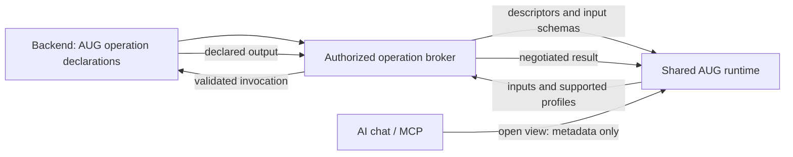

# Every new application should be usable through an AI chat, without making users learn a new frontend.

**Adaptive UI Gateway (AUG)** — an experimental protocol for exposing application capabilities to shared runtimes, including interfaces inside AI chats.

[](https://github.com/CELOTTOA/adaptive-ui-gateway/actions/workflows/ci.yml)

With AUG, backend developers declare operations, input schemas, effects and output
representations. A compatible runtime discovers those declarations, builds input controls,
requests confirmation when needed and renders supported results. Application logic and
authorization stay in the backend; one runtime can serve several conforming applications.

**Status: experimental application protocol `aug/0.2`, with a working reference runtime.**
The implementation includes an operation broker, a standalone/embedded browser runtime,
output negotiation and optional encrypted invocation persistence. An annotated OpenAPI
search adapter remains available. Production identity, broad host compatibility and
cross-application workflows remain open work.

## Why AUG exists

AUG began with a reflection on how people access information. Search engines such as
Google became a familiar place to look for answers. The hypothesis is that AI conversations,
with systems such as ChatGPT and Claude, could also become a common starting point for
using software. A user could describe an objective, discover the relevant application
capabilities and work through the task with an interface composed for that moment.

Today, using several applications often means learning several frontends: their navigation,
terminology and workflows. The question behind AUG is whether a familiar AI chat could
provide a common interaction layer, with tables, selections and other controls appearing
when the task needs them.

In that vision, applications continue to provide their domain logic, calculations,
business rules and authorization. Developers expose those capabilities through the AUG
contract; compatible runtimes interpret the declarations. Existing APIs may use adapters,
while new backends can implement the protocol directly. The shared runtime supplies the
interface for supported interactions, reducing the need for a separate application frontend.

The long-term question is: **can someone use an application they have never learned by
describing what they want to accomplish in an AI chat?** A further step would be completing
a task across several applications through that same interaction layer. Specialized
interfaces would still have a role in intensive work and tasks requiring precise control.

This is a direction to investigate, not a forecast established by the prototype.
Cross-application orchestration and general intent-driven workflows are not implemented.

## From protocol to interface

The backend identifies its outputs in terms of AUG representation profiles. The runtime
advertises what it can display; the broker selects a compatible representation permitted
for that audience before execution. This makes the contract explicit without requiring
every runtime to understand every possible backend result.

The reference runtime works without a model. A chat host can open it through the
`aug_open_runtime` MCP tool; the same module runs at `/runtime` in a browser. The earlier
search UI path also supports optional model-assisted planning, whose usability benefit
remains an evaluation question.



Inputs, confirmation tokens and results travel directly between the protected view and
gateway, outside MCP tool results. The optional search planner receives intent and
authorized metadata, not retrieved records or service credentials. **This channel separation
does not provide end-to-end encryption against the chat host**, which controls the view's
environment. SQLite encryption protects persisted invocation payloads, a separate boundary.
See [the publication record](docs/publication.md) for verification evidence and exclusions.

## Try it in five minutes

Requirements: Git, Node.js **22.14+ on the 22.x line, or 24.x**, and npm. No model account,
Docker, certificate installation or external backend is required for the default demo.

```sh
git clone https://github.com/CELOTTOA/adaptive-ui-gateway.git
cd adaptive-ui-gateway
npm ci
npm test
npm run demo
```

Open **http://127.0.0.1:4000/runtime**, enter `demo-analyst-token` and connect.
Select **Customer search**, enter `CANARY` in `q` and run the operation: the synthetic
tenant-a customer appears with the approved fields. Try `Torino` or an empty search next.
The original search-plan demo remains at **http://127.0.0.1:4000/**.

The sample backend listens on loopback port 4100; the gateway uses port 4000. Stop with
Ctrl+C. The credentials and records are deliberately public demo fixtures.
The operation runtime requires no model. For the original search-plan path, the planner is
deterministic unless a `GROK_API_KEY` is present in the environment or an optional local
`.envlocal` file. A clean checkout needs neither.

For an HTTP-only walkthrough and model configuration, see [Getting started](docs/getting-started.md).
For the actual renderer and request path, see [the walkthrough](docs/demo-walkthrough.md).

## What works today

| Area | Implemented scope |
|---|---|
| Discovery | Authorized backend-native operation descriptors; annotated read-only OpenAPI adapters |
| Planning | Shared runtime interprets schemas directly; legacy search planning supports an optional xAI provider |
| Protocol draft | Backend-declared output representations, runtime negotiation and an opt-in read-only HTTP binding; see [the contract](docs/protocol.md) |
| Operation draft | Backend-native declarations, JSON Schema inputs and an invocation broker with explicit confirmations; see [operations](docs/operations.md) |
| Generic runtime | One renderer for declared inputs, inline results, confirmations and recovery, in `/runtime` or the `aug_open_runtime` chat view; see [runtime](docs/runtime.md) |
| Persistent state | Optional encrypted SQLite invocation state, durable request receipts and conservative crash recovery; see [persistence](docs/persistence.md) |
| Validation | Operation input/output schemas, effect confirmations, tenant/scope checks; legacy UI/binding policies |
| Data access | Authenticated invocations and plan sessions; read adapter projects allowed fields and bounds rows |
| Rendering | Typed forms or JSON input; inline collections, JSON and text through fixed code and text nodes |
| MCP Apps | One configurable local stdio entrypoint for demo or external backends; metadata-only catalog includes input schemas |
| Tests | Contract, integration, stdio, TLS and opt-in live tests; no API key required for the main suite |
| Second backend | Archteathos theatre sheets through a specific read-only adapter, without changing AUG core packages |
| Protocol interoperability | Standalone Python backend and an independent Node terminal runtime; cross-checks with the original broker and browser runtime |

The application wire version is **`aug/0.2`**. Representation profiles such as
`aug.collection/0.1` have independent versions; the original search-plan format remains
`aug.ui/0.1`. Workspace packages are still private `0.1.0` packages; no npm release is implied.
[Current architecture](docs/architecture.md) describes the code. The broader RFC includes
unimplemented proposals such as OpenAPI write discovery and alternative UI serialization.

## Limits worth investigating

- OpenAPI import needs `x-aug-*` annotations. It supports flat scalar result arrays, scalar
  query inputs and local schema references; path parameters and arbitrary nested UIs are outside this slice.
- Native operations support JSON Schema inputs, with JSON-editor fallback for complex values.
  The runtime renders inline collections, JSON and text; references/PDFs, streaming and
  custom visual profiles are not yet rendered. OpenAPI import remains read-only even though
  backend-native registrations can declare effects with explicit confirmation.
- Backend credentials and user authentication in the demos are fixtures. OAuth, remote
  multi-user deployment and production credential management are not implemented.
- Legacy plan sessions and default operation state/audit handling are process-local. Optional
  SQLite persistence covers operation invocations and request receipts, with one owner per
  database; backend effects still require domain idempotency/reconciliation. The core checks response size, but its
  response-body limit currently applies after buffering; streaming enforcement is open work.
- The backend must enforce its own business rules and tenant boundaries. An AUG header
  is not a replacement for a backend authorization model.
- Host interoperability varies. Claude Desktop has a successful direct-query observation;
  the tested ChatGPT Desktop/Codex host blocks loopback HTTP through its CSP. Local HTTPS
  is tested, but the certificate and real-host HTTPS path remain unresolved.
- Keeping records out of a planner request does not remove sensitive content that a user
  types into their intent, or that a developer puts in metadata.

See [Security](SECURITY.md), [the threat model](docs/security-model.md) and
[the host compatibility record](docs/compatibility.md).

## Connect another backend

For a native integration, start with [the protocol](docs/protocol.md) and
[operation registrations](docs/operations.md): declare inputs, scopes, effects and output
offers, then register a handler in the broker. The backend supplies these semantics; AUG
does not infer them from arbitrary responses.

For an existing read API, use [the OpenAPI integration guide](docs/backend-integration.md)
and [the synthetic API's document](examples/customer-api/openapi.json). The MCP launcher
accepts an `AUG_ENV_FILE` profile containing the OpenAPI path, backend URL, separate
service/view tokens and explicit principal, tenant and scopes. `GatewayService`,
`OperationBroker` and `startGatewayServer` are available inside this monorepo, not as
published npm packages.

[Archteathos](examples/archteathos/README.md) is an optional example using a separate existing
checkout. Its adapter translates nested theatre sheets into the supported read-only shape.
That example demonstrates adapter integration, not automatic discovery of arbitrary applications.
No Archteathos data or source code is bundled in this repository.

For a framework-free implementation in another language, see
[the Python backend and terminal runtime](examples/independent/README.md). Their standalone
pair needs no AUG packages or build. [The interoperability exercise](docs/interoperability.md)
records cross-implementation checks and specification clarifications. With Python 3.11+
installed, run `npm run test:interop` to reproduce them; the standard `npm test` stays Node-only.

## Help shape the project

Useful contributions include an independent protocol implementation, representation/profile
conformance cases, a small backend adapter, host evidence or a review of the trust boundaries.
See [CONTRIBUTING](CONTRIBUTING.md), [the roadmap](docs/roadmap.md) and
[the initial contribution briefs](docs/community/README.md).

The [architecture RFC](adaptive-ui-gateway-architecture-spec-v0.3.md) records the broader
proposal. [Development notes](docs/status/2026-11-01-stato-sviluppo.md) and `docs/spikes/`
contain historical observations; the English guides above describe the current public entry point.

Initiated by **DevSoftIQ**. Distributed under the [MIT License](LICENSE).
