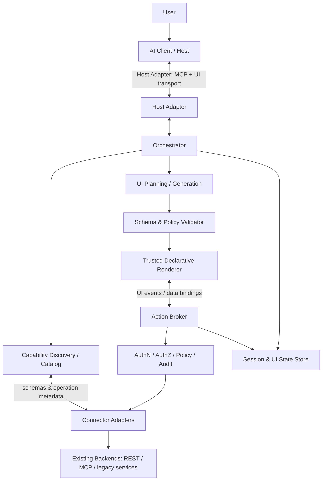
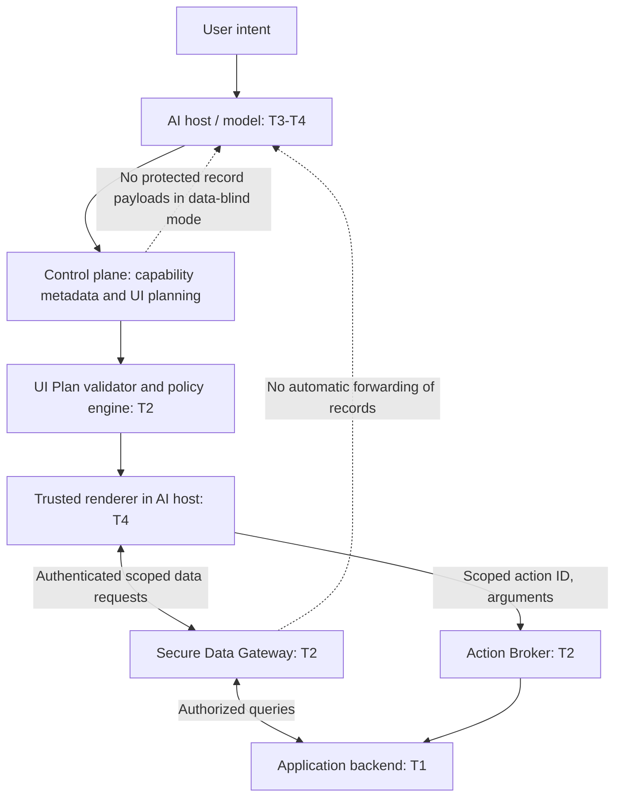

# Adaptive UI Gateway (AUG)
## Architecture Specification — Draft v0.3

**Status:** Architecture candidate / RFC-0001 (privacy architecture proposed; implementation validation pending)  
**Date:** 2026-11-01  
**Initiator:** DevSoftIQ  
**Target:** Open-source, general-purpose, vendor-neutral  
**Language:** English (canonical specification)

> **Reading this RFC against the code:** this document includes unimplemented proposals.
> The v0.1 implementation uses the internal `aug.ui/0.1` format and a fixed DOM renderer;
> it does not implement A2UI, write operations or MCP capability discovery. Start with the
> [README](README.md) and [current architecture](docs/architecture.md) for implemented behavior.

> **Mission:** Turn existing application capabilities into safe, task-specific, interactive user interfaces inside compatible AI clients, without hand-building a screen for every workflow.

## 1. Executive summary

Adaptive UI Gateway (AUG) is an integration and runtime layer between existing application backends and AI-assisted user experiences. It discovers application capabilities (initially OpenAPI and MCP tools), normalizes them into a semantic capability catalog, and supports generation of a **declarative UI specification** for a user's current task. A constrained renderer displays that specification in compatible clients; validated user actions are routed back to authorized backend operations.

AUG **does not** replace application business logic, invent a new universal transport protocol, or require the backend to be rewritten. It composes existing standards where practical. The proposed initial stack is MCP for tool access, MCP Apps for embedded presentation, and A2UI as the preferred declarative UI format behind an internal abstraction. **Published specifications and examples support architectural feasibility; real-client interoperability and exact SDK/version support remain acceptance tests, not assumptions.**

### 1.1 Goals

1. General-purpose operation across unrelated applications and domains.
2. Generate interfaces *on demand* from user intent and declared capabilities.
3. Avoid arbitrary model-generated executable HTML/JavaScript.
4. Preserve backend business rules, authorization and auditability.
5. Support both read-only and controlled write workflows.
6. Remain independent of model vendor, AI host, backend language and front-end framework.
7. Make the initial proof of concept reproducible by third-party developers.
8. Minimize model exposure to application data by design; enable data-blind UI planning where feasible.

### 1.2 Non-goals for v0.1

- Pixel-perfect reproduction of existing application interfaces.
- Autonomous discovery of undocumented or inaccessible private functions.
- Universal support for every MCP client or arbitrary UI component.
- Fully automatic, unrestricted destructive operations.
- Replacement of domain-specific desktop interfaces where precision is essential.
- An autonomous browser agent as the primary backend integration strategy.

## 2. Terminology

- **Capability:** A backend operation with a stable identifier, typed inputs/outputs, authorization requirements and side-effect metadata.
- **Catalog:** Normalized, versioned inventory of capabilities and data schemas.
- **UI Plan:** Model-proposed declarative description of components, bindings and actions for a task.
- **Renderer:** Trusted component implementation that interprets a validated UI Plan.
- **Action Broker:** Server-side execution path for UI actions with validation, permissions, confirmation and audit.
- **Host Adapter:** Integration between AUG and a particular AI client/runtime.
- **Connector Adapter:** Integration between AUG and a backend/API/tool provider.
- **Data Plane:** Authorized record retrieval and mutation path independent of model planning context.
- **Control Plane:** Intent, capability metadata and declarative UI planning path.
- **Data-blind planning:** UI generation from schemas and non-sensitive metadata without transmitting individual application records to the model.
- **Data classification:** Per-field/operation policy labels controlling permitted recipients and transformations.

## 3. Logical architecture



**Trust boundary:** The AI-generated UI Plan is **untrusted input**. It cannot define new privileges, execute arbitrary code, call unlisted endpoints, or bypass backend validation.

### 3.1 Modules

| Module | Responsibility | Initial implementation |
|---|---|---|
| `core` | Contracts, identifiers, error types, orchestration | TypeScript package |
| `discovery-openapi` | Parse OpenAPI operations and schemas | Adapter |
| `discovery-mcp` | Import exposed MCP tools and schemas | Adapter |
| `capability-catalog` | Normalize metadata and side effects | Versioned registry |
| `ui-planner` | Produce constrained UI Plans from intent/catalog | Model-provider abstraction |
| `ui-schema` | JSON Schema, semantic validation, versioning | Shared package |
| `renderer` | Approved components and bindings | Web component/React reference renderer, choice TBD |
| `host-mcp-apps` | Embed renderer in compatible AI hosts | Host adapter |
| `action-broker` | Execute allowlisted, authorized operations | Server-side service |
| `security` | Identity, policy, confirmations, audit | Cross-cutting package |
| `examples` | Demonstrations and fixtures | Sample APIs |

## 4. End-to-end execution flow

1. **Connect:** Developer registers a backend through an explicit OpenAPI document or MCP endpoint, with credentials configured separately.
2. **Discover:** AUG parses operations and schemas; it does not infer authorization from endpoint names alone.
3. **Annotate:** A developer or policy file declares business semantics, side effects, sensitivity, scopes and confirmation rules; auto-generated descriptions are reviewable.
4. **Request:** User asks the AI client to perform or explore a task.
5. **Select:** Orchestrator retrieves only relevant capabilities and permissible fields.
6. **Plan:** Model proposes a versioned UI Plan referencing catalog IDs and supported components.
7. **Validate:** Gateway checks schema, bindings, scopes, component constraints, action targets and data access policies.
8. **Render:** Compatible host displays the approved UI through its supported presentation mechanism.
9. **Interact:** UI events are sent to the Action Broker with session identity and action ID; no client-supplied credentials or unrestricted URLs.
10. **Execute:** Broker validates arguments, enforces permissions, requests explicit confirmation for sensitive changes and calls the backend.
11. **Update:** Structured results refresh bound state; UI may be replanned when the task changes.
12. **Audit:** Record capability, principal, decision, outcome and trace ID, excluding sensitive payloads by default.

## 5. Capability model

Each operation must have:

```json
{
  "id": "demo.customers.list",
  "source": "openapi",
  "sourceOperationId": "listCustomers",
  "description": "List customers with optional filters",
  "inputSchema": {"type":"object","properties":{"q":{"type":"string"}}},
  "outputSchema": {"type":"array","items":{"type":"object"}},
  "effect": "read",
  "requiredScopes": ["customers:read"],
  "confirmation": "none",
  "dataClassification": "internal",
  "version": "1"
}
```

`effect` is one of `read`, `write`, `destructive`, `external_side_effect`. Side-effect classification must be explicitly verified; an HTTP GET method is not sufficient evidence that an operation is harmless. Unknown effects default to the restrictive policy. The catalog is tenant-scoped where applicable.

## 6. Declarative UI Plan

The UI Plan is a **data structure, not executable source code**. The initial internal schema is intentionally small; adapters may translate to A2UI or another compatible representation after testing.

```json
{
  "schemaVersion": "aug.ui/0.1",
  "viewId": "customers-search",
  "title": "Customer search",
  "components": [
    {"id":"query","type":"text-input","label":"Search","bind":"filters.q"},
    {"id":"results","type":"data-table","dataRef":"customers","columns":[
      {"key":"name","label":"Customer"},
      {"key":"city","label":"City"}
    ]},
    {"id":"refresh","type":"button","label":"Search","actionRef":"searchCustomers"}
  ],
  "actions": [
    {"id":"searchCustomers","capabilityId":"demo.customers.list","args":{"q":{"stateRef":"filters.q"}},"resultRef":"customers"}
  ]
}
```

### 6.1 v0.1 component allowlist

`text`, `heading`, `text-input`, `number-input`, `select`, `checkbox`, `date-input`, `button`, `data-table`, `detail-panel`, `form`, `status-message`, `simple-chart`.

Every component has a typed contract, maximum nesting/size, accessibility requirements and permitted data bindings. No arbitrary scripts, HTML injection, dynamic imports, inline event code or unconstrained external resources.

### 6.2 Generation modes

- **Deterministic fallback:** derive basic forms/tables from typed schemas without an LLM.
- **Model-assisted:** model selects components and layouts from approved capabilities and component catalog.
- **Human-authored overrides:** optional reusable templates for regulated or complex workflows; not required for simple discovery.

This separation makes it possible to measure the *incremental* value of generative UI rather than conflating it with schema-to-form generation.

## 7. Security and privacy requirements

1. **Authentication:** authenticate users and backend connections separately; never send raw backend secrets to the model or renderer.
2. **Authorization:** enforce permissions server-side per operation, record and field; UI visibility is not an authorization boundary.
3. **Least privilege:** tools and fields exposed to the model are filtered by effective user scopes.
4. **Confirmation:** require user confirmation for writes with material effects, and stronger review for destructive/external actions.
5. **Injection resistance:** treat tool descriptions, backend data, model output and UI text as untrusted; do not promote retrieved content to instructions.
6. **Schema enforcement:** validate input/output against allowlisted contracts and reject unknown actions or components.
7. **Isolation:** tenant separation, scoped credentials, session expiration, rate limiting and request quotas.
8. **Audit:** immutable trace references for decisions and operations; redact personal data and secrets.
9. **Transport:** encrypted connections, origin restrictions, content security policy for embedded UI and dependency integrity checks.
10. **Replay protection:** idempotency keys for state-changing operations; CSRF/session-binding protections as relevant to host runtime.
11. **Privacy:** configurable retention and data minimization; explicit treatment of sensitive sectors such as health and employment.
12. **Data-plane isolation:** keep protected record payloads outside model tool results, prompts, traces and telemetry by default.
13. **Disclosure controls:** classify data and enforce recipient-specific egress rules before every model call, tool response and UI event.


## 7A. Privacy-by-architecture (normative proposal for v0.3)

### 7A.1 Security objective and threat model

**Objective:** For supported *data-blind* workflows, the model receives user intent, authorized capability metadata, schemas and opaque data-source references, **not individual protected backend records**. This is a testable non-disclosure property for the **model request/response channel**, not a blanket claim that data never reaches a third-party host.

Trust zones: (T1) application backend and tenant data; (T2) AUG server-side policy, broker and data gateway; (T3) AI model/provider; (T4) embedded UI renderer and AI host; (T5) logs/telemetry/analytics. T3, T4 and T5 are **separate disclosure destinations** and require independent policy decisions. The renderer may execute within an iframe/sandbox controlled by a third-party AI client; a separate data path does **not** imply local-only processing or confidentiality from that host. Assess host network permissions, origins, iframe isolation, data access, logging and contractual controls per deployment.

Threats in scope: accidental prompt inclusion, tool-result leakage, cross-tenant access, prompt injection from retrieved content, malicious UI plans, forged bindings/action IDs, credential exposure, excessive logging, unauthorized exports and inference from aggregates. Out of scope for a generic AUG guarantee: protection against a compromised host or browser, a malicious authorized backend, and disclosures intentionally requested by an authorized user; these require separate controls and disclosures.

### 7A.2 Control plane versus data plane



**Required invariant:** A generated UI plan may name approved data sources, columns, filter operators and action IDs, but must never carry backend credentials, unrestricted URLs, protected record values or bearer tokens. Data bindings are resolved by a trusted gateway using the authenticated principal, tenant, session, scopes and field-level policy; opaque references alone confer no access.

### 7A.3 Data classification and egress policies

Initial policy labels: `public`, `internal`, `confidential`, `restricted` (deployment-configurable; not a substitute for legal classifications). Every capability, field, tool output and derived result inherits an effective label. Unknown fields default to `restricted` until reviewed. Policy evaluates **subject + tenant + purpose + destination + field + operation + data class**; deny by default.

| Destination | Default handling of confidential/restricted data |
|---|---|
| External model context (T3) | Denied; allow only through explicit policy and appropriate lawful/contractual basis |
| Embedded renderer in third-party host (T4) | Denied unless host/deployment risk review permits scoped rendering |
| AUG server-side broker (T2) | Allowed only as needed for authorized operation |
| Logs, traces, crash reports (T5) | Redacted/minimized; raw payload capture disabled |
| Exports/downloads | Explicit permission, user confirmation where appropriate, audit |

A policy exception must be explicit, scoped and auditable; a user's chat instruction cannot override organizational policy. Aggregations, anonymization and pseudonymization must be assessed for re-identification and inference risk before release.

### 7A.4 Operating modes

- **Standard:** Authorized application data may be disclosed to a configured AI provider under documented policy, retention and processing terms. No implicit unrestricted disclosure.
- **Protected (default for PoC):** Data-blind UI planning; model receives approved schemas, semantic metadata and opaque references. Record values are fetched via the Secure Data Gateway only after authorization, and only if the host renderer is an approved recipient. Model-based analysis of individual records is disabled unless separately authorized.
- **Sovereign:** Private/local model, gateway and a controlled renderer/host within the organization's trust boundary. Merely selecting a local model while displaying data in a third-party AI client does **not** satisfy Sovereign mode.

Modes are policy profiles, not certifications or automatic GDPR compliance claims. A host lacking the necessary isolation or network capability must fall back to a controlled standalone renderer or refuse the protected operation.

### 7A.5 Declarative UI and data binding contract

Illustrative, non-final internal UI IR (not a claim of native A2UI schema compatibility):

```json
{
  "uiPlanVersion": "0.1",
  "component": "data-table",
  "dataSourceId": "customers.overdue",
  "columns": ["customer_name", "amount_due", "due_date"],
  "filter": { "field": "amount_due", "op": "gt", "value": 5000 },
  "actions": ["customers.view"],
  "bindingPolicyId": "protected.customer-overdue.v1"
}
```

The example contains no customer records. `dataSourceId`, `bindingPolicyId` and action IDs must be allowlisted server-side. The renderer sends a scoped query to the gateway; the gateway revalidates principal, tenant, selected fields, filters, pagination, row-level permissions, rate limits and destination authorization. No raw SQL, arbitrary endpoint URL or model-supplied authorization scope is accepted. Query results must not be mirrored into conversational tool results or unredacted traces.

### 7A.6 Identity, session, transport and browser controls

- Prefer delegated, short-lived, audience-bound authorization; keep backend secrets server-side. Never embed bearer credentials in UI plans, URL query strings or model prompts.
- Enforce tenant and row/field authorization on **every** data fetch and mutation, including refresh, pagination and export.
- Validate host origin, CSP, frame restrictions, permitted network destinations and cross-origin messaging for each supported client; do not assume identical host capabilities.
- Protect state-changing actions with explicit authorization, confirmation, CSRF defenses where relevant, replay protection and idempotency keys.
- Use TLS, scoped sessions, bounded response sizes, strict content encoding and sensitive-field masking; do not trust client-provided classification labels.
- Treat user-provided text, backend descriptions, document content and tool responses as untrusted input; test prompt-injection and exfiltration paths.

### 7A.7 Model-dependent analysis and controlled disclosure

When a task genuinely requires the model to interpret protected records, AUG must choose one of: (a) perform the computation server-side and disclose only policy-approved aggregates; (b) use an approved private/local model inside the permitted trust boundary; (c) request an explicit, policy-authorized disclosure to an external model with appropriate notice; or (d) refuse/offer a safer alternative. Never silently downgrade from Protected to Standard.

### 7A.8 Logging, retention and GDPR governance

Default logs contain operation ID, tenant pseudonymous identifier, policy decision, destination, trace ID, timestamp and outcome—not record bodies, prompts containing personal data, credentials or unredacted errors. Define retention and deletion schedules per deployment; minimize telemetry and third-party observability integrations. Provide documented export/deletion and incident-response hooks where applicable.

For personal data, deployments must determine controller/processor roles, lawful basis, processor agreements, international transfer mechanisms, retention, data-subject rights, technical/organizational measures and whether a DPIA is required. This specification describes engineering safeguards, **not a legal determination of GDPR compliance**.

### 7A.9 Mandatory privacy acceptance tests

1. Seed a synthetic dataset with unique canary names, identifiers and amounts. Run data-blind table/filter workflows and assert **zero canary values** in captured model inputs, outputs, tool messages and model-bound traces.
2. Verify that an authorized renderer can fetch only permitted rows and fields; unauthorized user, tenant, column, action and export attempts fail closed.
3. Verify that a guessed or replayed `dataSourceId`/session/action ID does not grant access.
4. Verify that protected data does not appear in application logs, error reports, analytics or URLs; inspect all configured egress destinations.
5. Attempt prompt injection in API descriptions, records and documents; confirm that policies cannot be overridden by untrusted content.
6. Test host-specific iframe/origin/network behavior on ChatGPT and Claude separately; mark `supported`, `limited` or `unsupported` with evidence.
7. Verify no silent mode downgrade: if host isolation is insufficient, use a controlled renderer or deny the request.
8. Verify explicit authorization and audit of any model-bound disclosure; verify no model disclosure occurs by default in Protected mode.

**Go/no-go:** Protected-mode data-blind planning is accepted only when canary tests pass, authorization isolation passes, and the chosen renderer's host-specific disclosure boundaries are documented. The tests demonstrate bounded properties, not universal zero-data-leak guarantees.

### 7A.10 Privacy architecture decisions to record

- ADR-009: Control/data plane separation and default Protected mode.
- ADR-010: Data classification, recipient-based egress policy and fail-closed defaults.
- ADR-011: Host trust model, controlled-renderer fallback and Sovereign-mode definition.
- ADR-012: Model disclosure workflow, audit/retention and privacy test harness.

## 8. Compatibility strategy

### 8.1 Standards and responsibilities (Phase 0 outcome)

| Standard / layer | Responsibility | AUG decision |
|---|---|---|
| MCP | Discovery/invocation of tools and resources | Adopt for AI-facing tool integration |
| MCP Apps | Embedding interactive UI resources in supporting hosts | Adopt as initial host presentation adapter |
| A2UI | Declarative UI representation and component/data/action descriptions | Preferred first output format; retain a format-neutral internal UI IR |
| OpenAPI 3.x | Discovery of REST backend capabilities | First backend discovery adapter |
| AG-UI | Agent-to-frontend events and shared state | Defer; optional for independent AUG client |
| MCP-UI | Earlier embedded UI ecosystem | Compatibility research only, not primary target |

**Integration pattern:** AUG emits a validated, versioned UI IR; an A2UI serializer translates it into a supported A2UI profile; a trusted A2UI renderer is bundled as a fixed MCP Apps UI resource. Dynamic generation updates *data and declarative UI plans*, not arbitrary executable JavaScript or HTML. The MCP Apps host bridge handles approved messages and tool invocations. Backend operations always pass through the Action Broker.

### 8.2 Phase 0 evidence and confidence

The published MCP Apps specification/SDK and OpenAI Apps SDK establish a documented route for interactive UI resources in compatible hosts. The A2UI project documents declarative UI and renderer implementations. Public integration material describes combining A2UI with MCP Apps. These findings establish **design feasibility**, not proof that one compiled bundle works unchanged across all ChatGPT and Claude Desktop versions.

Primary documentation to review and pin to exact commits/releases before implementation:

- MCP Apps SDK/specification: https://github.com/modelcontextprotocol/ext-apps
- OpenAI Apps SDK documentation: https://developers.openai.com/apps-sdk/
- A2UI specification and examples: https://github.com/a2ui-project/a2ui
- A2UI + MCP Apps discussion: https://developers.googleblog.com/a2ui-and-mcp-apps/
- AG-UI: https://github.com/ag-ui-protocol/ag-ui

**Evidence levels:** (1) documented architecture, (2) working local example, (3) verified ChatGPT integration, (4) verified Claude Desktop integration. Only level 1 is established by this document; levels 2–4 require executable tests and a dated compatibility report. Avoid claims of full feature parity.

### 8.3 Host compatibility test matrix

| Test | Standalone harness | ChatGPT | Claude Desktop |
|---|---|---|---|
| UI resource loads and renders | Required | Required | Required |
| Declarative plan update without rebuilding bundle | Required | Required | Required |
| Read-only tool invocation | Required | Required | Required |
| Form submission with server-side validation | Required | Required | Required |
| Confirmation before write action | Required | Required | Required |
| Authentication and scoped authorization | Required | Required | Required |
| Session state, reconnect and error recovery | Required | Required | Required |
| Resizing, CSP/sandbox, navigation restrictions | Required | Required | Required |

**Current status:** Not yet executed in this project. Record exact client versions, OS, SDK commits, transport, auth method, screenshots/logs and pass/fail for each test. ChatGPT and Claude Desktop may require distinct packaging, installation, permission or authentication flows; these differences belong in host adapters.

### 8.4 Interface-generation contract

1. The AI planner receives a **permission-filtered** catalog of capability descriptions, schemas, constraints and examples; never credentials.
2. The planner produces an internal typed **UI IR** with component tree, data bindings, events and capability IDs.
3. A strict validator checks schema version, allowed component types, data source references, action IDs, field-level constraints, size/depth limits and accessible labels.
4. The A2UI adapter serializes only the supported A2UI subset; unsupported components fall back to safe standard widgets or a textual result.
5. A trusted, precompiled renderer displays the plan and emits structured UI events. No model-generated scripts, CSS injection, arbitrary URLs or raw HTML.
6. The Action Broker revalidates inputs, permissions, tenancy, idempotency and write confirmation **on the server**; model/UI validation alone is insufficient.
7. Changes in backend schemas or user permissions invalidate cached plans and require revalidation.

### 8.5 Minimum security gates for the PoC

- OpenAPI discovery is allowlisted; block private-network SSRF, unsafe redirects and arbitrary remote spec fetching by default.
- Read/write operations are classified; writes use explicit confirmation and audit IDs. Destructive actions excluded from initial PoC.
- Host-provided user identity is not trusted without verification; use authenticated server sessions and least-privilege backend tokens.
- Treat tool descriptions, API data and model output as untrusted; prevent prompt-injection content from becoming executable actions.
- CSP, origin validation, sandbox permissions and message authentication follow each host's current specification.
- Record redacted telemetry; never log credentials or sensitive record contents by default.

### 8.6 Architecture decision records to open

- **ADR-001:** MCP Apps as initial UI transport; alternate host adapters permitted.
- **ADR-002:** A2UI as first serialization target, internal UI IR remains independent.
- **ADR-003:** Precompiled renderer + declarative plans; no generated executable code.
- **ADR-004:** Server-side Action Broker as sole write path.
- **ADR-005:** First PoC uses OpenAPI 3.x; MCP backend discovery follows.

## 9. Reference implementation

**Suggested stack (provisional):** TypeScript, Node.js LTS, JSON Schema validation (e.g. Ajv), HTTP adapter, MCP SDK, a precompiled trusted A2UI-capable renderer, containerized example services. Choose the UI framework after testing host sandbox restrictions; do not hard-code React as a protocol requirement.

**Deployment modes:** local development, self-hosted single-tenant, and eventually multi-tenant service. Secrets reside in server-side configuration or a secrets manager, never in a generated UI Plan.

### 9.1 Proposed monorepo

```text
adaptive-ui-gateway/
├── apps/
│   ├── gateway-server/
│   └── playground/
├── packages/
│   ├── core/
│   ├── capability-catalog/
│   ├── discovery-openapi/
│   ├── discovery-mcp/
│   ├── ui-schema/
│   ├── ui-planner/
│   ├── renderer/
│   ├── host-mcp-apps/
│   ├── action-broker/
│   └── security/
├── examples/
│   ├── customer-api/
│   └── inventory-api/
├── tests/
│   ├── contract/
│   ├── integration/
│   ├── security/
│   └── e2e/
├── docs/
│   ├── architecture/
│   ├── quickstart/
│   └── adr/
├── .github/
├── LICENSE
├── CONTRIBUTING.md
├── SECURITY.md
└── README.md
```

## 10. Proof of concept: v0.1 acceptance test

**Input:** An unfamiliar, documented sample API, loaded from its OpenAPI file.  
**Output:** Three distinct interfaces produced from the *same* capability catalog, without manually authoring those screens.

1. **Search:** searchable/filterable table with detail view.
2. **Create:** validated form with explicit confirmation and observable backend result.
3. **Analyze:** summary/chart view from typed API data.

### Acceptance criteria

- New sample API connected by configuration and schema import, without editing renderer source.
- Three task-specific UI Plans produced, validated and rendered.
- All actions target registered capabilities only; unknown action is rejected.
- Unauthorized capability is neither executable nor exposed in the permitted catalog.
- Write action requires confirmation and logs an auditable outcome.
- Protected-mode UI planning passes the synthetic-data canary tests and host trust-boundary checks in §7A.9.
- Generated invalid schema produces a safe error/fallback, not execution.
- Same demo runs in standalone harness; both ChatGPT and Claude Desktop are tested against the matrix in §8.3, with any limitations documented. A single-host success is a partial milestone, not full interoperability.
- Reproducible quickstart from clean checkout with documented prerequisites.

### Evaluation metrics

- Setup time for a new API; manual annotation effort.
- UI Plan validity rate; action success rate; task completion rate.
- Number of security-policy violations correctly blocked.
- Protected-record disclosure count by destination (model, renderer, telemetry); target zero model-bound canaries in Protected data-blind workflows.
- Generation latency, render latency, token cost per workflow.
- User usability measures against deterministic schema-derived forms.

No performance or success-rate targets are asserted before a baseline is measured.

## 11. Phased roadmap

| Phase | Deliverable | Exit condition |
|---|---|---|
| 0 — Research | Host/protocol compatibility spike; architecture decisions | Evidence-backed matrix and selected SDK versions |
| 1 — Contracts | Capability catalog + UI Plan schema + validator | Contract tests passing |
| 2 — Backend integration | OpenAPI importer + demo backend | Read/write capabilities mapped |
| 3 — UI runtime | Approved renderer + state bindings + broker | Three demo workflows functional |
| 4 — AI generation | Provider abstraction + constrained planner + fallback | UI Plans generated from intent |
| 5 — Host integration | MCP Apps adapter for at least one client | End-to-end interactive demo |
| 6 — Open-source launch | Docs, license, CI, examples, threat model | External developer can reproduce demo |

## 12. Open-source governance

- **License candidate:** Apache-2.0, subject to dependency and trademark review.
- Public issues, discussions, ADRs, contribution guidelines, security disclosure process and semantic versioning.
- Brand-neutral core; DevSoftIQ may be acknowledged as founding sponsor and first real-world adopter.
- Vendor-specific host/model adapters are optional packages, not dependencies of `core`.
- Publish a clear limitations document and avoid unsupported “works everywhere” claims.

## 13. Risks and mitigations

| Risk | Mitigation |
|---|---|
| MCP host UI support differs | Host adapter boundary; standalone renderer fallback |
| API schemas lack business semantics | Explicit annotations, conservative defaults, developer review |
| Model hallucinates fields/actions | Strict schema + catalog ID allowlist + broker validation |
| Dynamic UIs are confusing | Accessibility, consistent components, user tests, deterministic fallback |
| Sensitive operations are executed incorrectly | Server-side policy, confirmation, audit, idempotency |
| Schema/protocol evolution | Versioned contracts, adapters, compatibility test suite |
| High generation cost or latency | Cache validated UI Plans, narrow catalog context, deterministic paths |
| Legacy front-end dependencies | Selective service extraction; UI automation only as temporary bridge |
| Protected records leak into model or telemetry | Control/data separation, egress policy, synthetic canary tests |
| Third-party host can observe rendered data | Explicit host trust review; controlled-renderer fallback; no false local-only guarantees |

## 14. Open architecture decisions (ADRs required)

1. Internal UI Plan schema vs adopting A2UI directly as the canonical schema.
2. Renderer framework and component portability across hosts.
3. Local vs remote model orchestration; provider abstraction and privacy modes.
4. Identity propagation and delegated authorization across host, gateway and backend.
5. State ownership: host, gateway session, or backend.
6. Streaming UI updates vs complete plan replacement.
7. Scope and limitations of automatic API semantic annotation.
8. Licensing, project name availability and package namespace.
9. Privacy ADRs 009–012 in §7A.10, including host trust and recipient-based disclosure controls.

## 15. First implementation sprint

- [ ] Create repository, license proposal, README and governance files.
- [ ] Confirm official MCP Apps and A2UI specifications and versions.
- [ ] Test a minimal embedded UI in each target AI host separately.
- [ ] Define `Capability` and `UIPlan` JSON Schemas.
- [ ] Build OpenAPI importer for read-only endpoints.
- [ ] Build deterministic table/form renderer.
- [ ] Add model-assisted planner behind an interface.
- [ ] Implement policy-enforced Action Broker and test denial paths.
- [ ] Publish a 5-minute local quickstart and recorded demonstration.
- [ ] Implement Protected-mode synthetic canary egress tests and deny-by-default field policy.
- [ ] Document model/renderer/telemetry trust boundaries per host.

## 16. Success definition

AUG v0.1 succeeds if an independent developer can supply an unfamiliar OpenAPI description, connect it to the gateway, and obtain **multiple safe, useful, interactive, task-specific interfaces** in a supported AI client **without hand-coding each interface**.

This document is a proposal, not a claim of implemented functionality. Architectural assumptions, client compatibility and protocol interoperability must be validated during Phase 0.

## 17. Phase 0 validation report and next gate (added in v0.2)

**Decision:** Proceed to a bounded technical spike. The architectural combination is plausible and supported by published projects; production interoperability has **not** been established by hands-on testing in this specification.

**Spike deliverables:** (a) pinned dependency versions and lockfile; (b) minimal MCP Apps renderer hosting one A2UI plan; (c) runtime plan update; (d) read and confirmed-write round trips through Action Broker; (e) host-by-host compatibility log; (f) reproducible Docker/local quickstart.

**Go/no-go gate:** Continue with AUG's general-purpose capability discovery only after the fixed renderer can render two different declarative plans without a rebuild, and one complete tool round trip succeeds. Mark ChatGPT and Claude separately as supported, limited or unsupported based on observed results.

**Historical change log v0.2:** Promoted A2UI + MCP Apps to the reference integration strategy; added evidence levels, compatibility matrix, UI generation contract, security gates, ADRs and an explicit experimental gate. No unexecuted interoperability test is represented as passed.


## 18. v0.3 privacy amendment and implementation gate

**Change log v0.3:** Added normative privacy-by-architecture proposal (§7A), explicit control/data plane separation, per-destination disclosure policies, Protected/Standard/Sovereign profiles, data-blind binding contract, host trust boundaries, synthetic canary acceptance tests, GDPR governance considerations and privacy ADRs. Updated PoC acceptance criteria, metrics, risks and first sprint. **No runtime privacy tests or host-specific verification are claimed to have been executed.**

**Next implementation gate:** Build the minimal protected read-only flow first: OpenAPI discovery → metadata-only UI planning → validated declarative plan → authorized renderer fetch → synthetic canary capture of all model-bound traffic. Add write operations only after that test passes.
