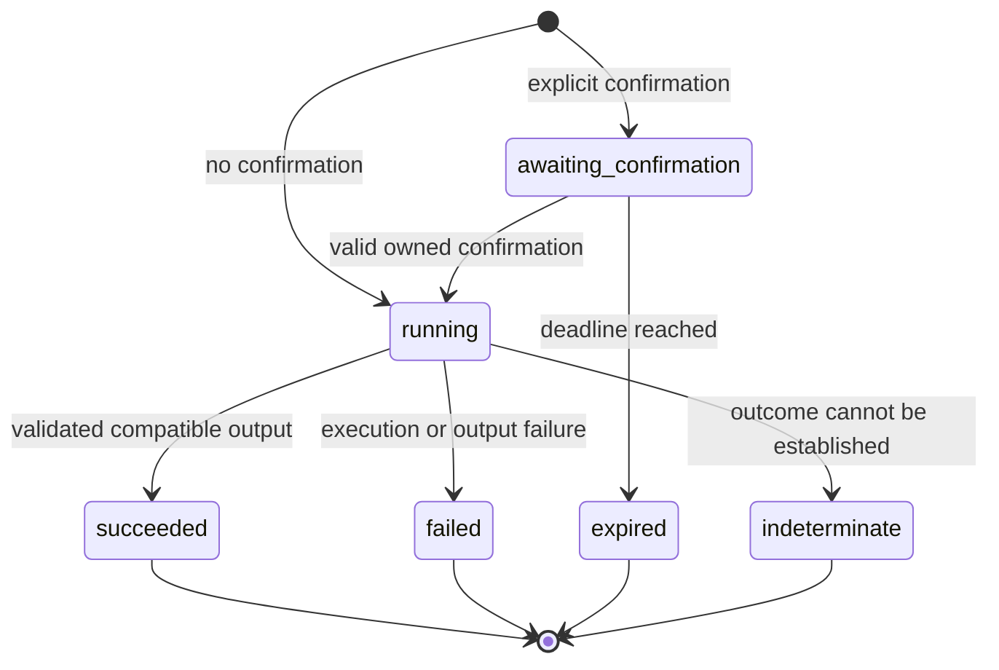

# AUG operations and invocation lifecycle — draft 0.2

An AUG backend declares operations as well as [output representations](protocol.md).
Each operation has an identifier and exact version, an input schema, its effect,
confirmation requirements and preference-ordered output offers. A runtime can discover
what it can invoke without knowing a particular backend or constructing a UI plan first.

The contracts live in `@aug/protocol/operations`. `OperationBroker` is the backend-side
reference implementation exported by `@aug/gateway-server`; it is distinct from a visual
runtime embedded in a chat.

## Operation declaration

```json
{
  "protocolVersion": "aug/0.2",
  "id": "demo.customers.list",
  "version": "1",
  "title": "Customer search",
  "description": "Search synthetic customer records",
  "effect": "read",
  "confirmation": "none",
  "inputSchema": {
    "type": "object",
    "additionalProperties": false,
    "properties": {
      "q": { "type": "string", "maxLength": 200 },
      "limit": { "type": "integer", "minimum": 1, "maximum": 100 }
    }
  },
  "output": [
    {
      "id": "collection",
      "profile": "aug.collection/0.1",
      "mediaType": "application/json",
      "audiences": ["view"],
      "deliveryKind": "inline"
    }
  ]
}
```

An output offer is a promise without result data. It lets the backend negotiate before
executing an operation, including one with side effects. Actual output must use declared
representation IDs, profiles, formats and delivery kinds, and cannot widen their audiences.
The preselected representation must be present on success.

Input schemas are backend-owned JSON Schema draft-07 objects with an object root. The
broker compiles them at registration and checks supported constraints before execution:
required fields, nested structures, types, ranges, patterns and unknown-property rules.
It does not coerce types, insert defaults, remove extra fields, fetch remote schemas or
accept asynchronous validators. Invalid/unsupported schemas fail registration. Formats
and custom keywords need an explicitly supported implementation. Request bodies never
provide executable code, operation definitions or schemas.

Effects are `read`, `write`, `destructive` and `external_side_effect`. Every non-read effect
requires `confirmation: "explicit"`; reads may also require it. Permissions and domain
rules remain backend responsibilities. Validation and a token do not grant authorization.

## Invocation lifecycle



Each invocation identifies its operation/version and has a monotonically increasing
`revision`. Revisions advance on state transitions; a consumer may miss intermediate
states between requests. Repeated snapshots at the same revision must agree. Terminal
invocations never reopen. A synchronous producer can return a terminal result on the
initial request; consumers must not assume that every operation needs polling.

Payloads depend on state:

| State | Additional payload |
|---|---|
| `awaiting_confirmation` | Token, deadline and exact saved input for review in the view |
| `running` | No result or confirmation payload |
| `succeeded` | Only the negotiated representation |
| `failed` | A safe code; no raw backend message |
| `expired` | No result or confirmation payload |
| `indeterminate` | `EXECUTION_OUTCOME_UNKNOWN`; backend reconciliation required |

Terminal invocations cannot restart. Retrying a failed effect does not cause another
execution under the same retained request ID. A new attempt requires a new request ID
and, for effects, a new confirmation. Backends must reconcile uncertain effects first.

This lifecycle describes an invocation, not an arbitrary business workflow graph.
Cross-operation dependencies, business-state transitions, compensation, cancellation and
streaming progress are not standardized yet. Domain preconditions remain handler checks.

## Confirmations, retries and limits

The broker binds confirmation to the authenticated user/tenant, exact operation version,
immutable input and negotiated runtime declaration. Confirmation accepts only invocation
ID and token; it cannot replace inputs or endpoints. Authorization is checked at discovery,
invocation, status, confirmation and immediately before handler dispatch. Registrations
are immutable for the broker lifetime.

`confirmation.expiresAt` is an absolute Unix epoch timestamp in milliseconds. Tokens and
invocation IDs are opaque strings within the schema bounds; a runtime must not assume
that either uses UUID syntax. Confirmation tokens belong only in the protected view.

State changes synchronously before execution. Repeated/concurrent confirmations return
existing state instead of starting another handler. Input and execution context are
detached and frozen. Expired confirmation cannot start an operation. A cooperating trusted
view must obtain the user's approval; a token does not prove a human gesture or protect
against a compromised chat host.

Every invocation has a `requestId`. Deduplication is scoped to user/tenant and fingerprints
operation/version, input and runtime declaration, independently of object-key order.
Reusing the ID for a different request returns a conflict. Returned snapshots are detached.

Equivalent JSON numbers, such as integer `1` and `1.0`, represent the same input value;
booleans remain a different type. This defines value equality for the accepted input,
not a standardized cryptographic fingerprint encoding across implementations.

The default store is in memory: limits are 1,000 retained/active invocations, a five-minute confirmation
deadline and fifteen-minute retention after terminal state. Running work is not evicted;
stalled handlers can occupy capacity. Limits are configurable. Expiry removes records and
deduplication entries; restarts also lose them. **This finite process-local window is not
durable exactly-once execution.** Backends with real effects must implement durable
idempotency/reconciliation, using the supplied request ID and authenticated identity.

The optional [persistent adapter](persistence.md) retains encrypted state and durable request
receipts. Interrupted running work becomes indeterminate and is never automatically replayed.
Errors after dispatch of an effect also require reconciliation, even without persistence.

## Native registrations and the read adapter

`OperationBroker.register()` accepts an `operation` descriptor, a synchronous
`authorize(principal)` guard that must return exactly `true`, and an `execute(input, context)`
handler returning an AUG output or promise. Optional `authorizeInvocation(input, principal)`
checks current resource-level access to the saved inputs. Context contains authenticated principal,
request ID and invocation ID. Duplicate operation IDs fail registration. No model chooses
handlers, endpoints, credentials or authorization policies.

`GatewayServiceOptions.operations` and `GatewayServerOptions.operations` accept the same
registrations. The [HTTP integration test](../tests/integration/operations-flow.test.mjs)
contains runnable native calculation, confirmed synthetic write and failure examples.

Existing OpenAPI reads also receive an adapter that calls the protected data gateway
directly, without a UI plan or planner, projecting only authorized fields. It declares
collection and JSON alternatives, always view-only. Existing plan/query and MCP contracts
retain their previous behavior.

## Reference HTTP binding

All routes require Bearer authentication and exact-origin checks. JSON responses use
`Cache-Control: no-store`. Destination is fixed to `view`; no invocation tool or confirmation
token is exposed through MCP.

| Route | Request / response |
|---|---|
| `POST /v1/aug/operations` | No body required; returns `{ "protocolVersion": "aug/0.2", "operations": [...] }` |
| `POST /v1/aug/invocations` | Invocation request; returns initial or retained state |
| `POST /v1/aug/invocations/control` | `status` or `confirm`; returns owned state |

Discovery returns HTTP 200, including an empty `operations` array for an authenticated
principal with no permitted operations. Descriptors contain metadata, not result records.

An invocation needs no UI plan:

```json
{
  "protocolVersion": "aug/0.2",
  "requestId": "customer-search-42",
  "operationId": "demo.customers.list",
  "operationVersion": "1",
  "input": { "q": "Torino", "limit": 10 },
  "runtime": {
    "protocolVersions": ["aug/0.2"],
    "profiles": ["aug.collection/0.1"],
    "mediaTypes": ["application/json"],
    "deliveryKinds": ["inline"]
  }
}
```

A control request has `protocolVersion`, `action` (`status` or `confirm`) and `invocationId`.
Confirmation adds `token` from the pending state. Extra fields, including replacement input,
are rejected. Running/awaiting states return HTTP 202; terminal states return 200. Handler
and output failures of reads produce terminal `OPERATION_FAILED` without raw messages.
An uncertain effect produces `EXECUTION_OUTCOME_UNKNOWN` in the indeterminate state.

A valid repeated confirmation returns the retained state without another dispatch.
An invalid token is still refused after completion. A successful HTTP response contains
one invocation snapshot, not an invocation wrapper or the producer's full output envelope.

Malformed input/messages return 400, denied tokens 403, unavailable operations/invocations
404, version/idempotency/expiry conflicts 409, incompatible runtimes 406 and capacity
exhaustion 503. Compatibility is checked before any handler executes.

Discovery metadata must be authored without private values. Inputs, tokens, full invocation
state and results belong on the protected view data plane. Optional `onEvent` audit receives
only operation/version, principal/tenant IDs, state and a safe failure code. It receives no
input/output, request/invocation IDs or tokens. Audit failures do not alter execution.

## Schemas and verification

- [Operation](../packages/protocol/src/schemas/operation.json)
- [Invoke request](../packages/protocol/src/schemas/invoke.json)
- [Control request](../packages/protocol/src/schemas/control.json)
- [Invocation state](../packages/protocol/src/schemas/invocation.json)

Register the [output](../packages/protocol/src/schemas/output.json) and
[runtime](../packages/protocol/src/schemas/runtime.json) schema IDs locally before compiling
referring schemas. Semantic checks additionally enforce confirmation, unique offers,
profile compatibility, output audiences and allowed state transitions.

Run `npm test`. Tests cover schemas, replay, ownership, immutable confirmations, expiry,
safe failures and real HTTP execution against synthetic/native backends. They do not claim
real production writes. The [operation runtime](runtime.md) now consumes these contracts
through a shared browser interpreter for the supported inputs and inline profiles.

The [interoperability exercise](interoperability.md) also checks an independent Python
producer and terminal consumer against these contracts. Run `npm run test:interop` with
Python 3.11+ to reproduce the cross-implementation matrix and language-neutral wire vectors.
