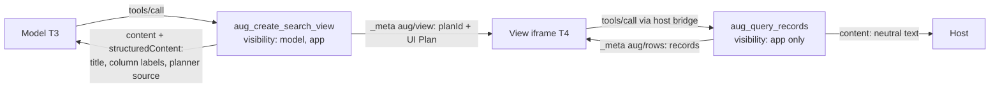

# Spike: MCP Apps host adapter on Claude Desktop

Status: **direct HTTP plan creation and query verified in real host logs** (Windows, Claude Desktop 4.4212.0, MSIX install)

## Current flow — 2026-11-03

The current version sends no plans, session ids or records through MCP results. The view creates
plans and queries records directly over HTTP to its per-process loopback gateway. Before its
first fetch, a Claude view calls the app-only `aug_register_view_origin` tool with **only its
browser origin**. The gateway enrolls that exact origin for this process, with strict host-name
validation and a limit of 128 dynamic registrations. HTTP authentication remains mandatory.

The live host reached the gateway but its preflight received 403: the sandbox origin changed
between conversations. Pinning a previously observed origin was insufficient. Claude's
[official troubleshooting guide](https://claude.com/docs/connectors/building/mcp-apps/troubleshooting#uidomain-validation-fails)
states that local stdio connectors cannot use `ui.domain` for a stable sandbox origin.

Local verification: **66 passed, 2 live skipped** (68 tests), build included. Two real stdio
processes prove that enrollment enables only the exact origin on one instance, followed by
direct plan creation and query. The browser glue tests prove that only origin metadata enters
the bridge.

**Real Claude Desktop evidence — 2026-11-03, 08:28 CET:** a new sandbox origin,
`https://3321176280071b5922172a5004629362.claudemcpcontent.com`, reached the per-process gateway
on port 51009 after the view's metadata tool call. Plan preflight returned 204, real Grok
planning took 1232 ms and POST /v1/plans returned 201. Query preflight returned 204 and
POST /v1/data/query returned 200; the audit recorded one authorized row for tenant-a.
The current AUG log session contains no record canaries or demo tokens and no preflight 403.

This proves the direct channel succeeded through the real sandbox. It does not establish
the search filter, visually rendered values, the model's ability to quote those values or
host-side retention. No new model-context challenge was sent during this verification.

Origin enrollment trusts the local MCP connection; app-only visibility is not authorization.
It never grants access to records without the separate HTTP token and gateway policy checks.
The historical results below concern the removed `_meta` data transport and do not validate
the current design. See the [development status](../status/2026-11-01-stato-sviluppo.md).

## Historical spike — superseded transport
Date: 2026-11-01 · Spec: MCP Apps 2026-01-26 (stable) · SDK: `@modelcontextprotocol/ext-apps@2.0.3`, `@modelcontextprotocol/server@2.3.1`

## Question

Can Protected-mode data reach the user inside an MCP Apps host (T4) **without** entering the
model context (T3)? This is the remaining go/no-go item of spec §7A.9: *document the host's
disclosure boundaries*.

## What the MCP Apps spec guarantees (and does not)

| Topic | Spec | Strength |
|---|---|---|
| Tools without `"model"` in `_meta.ui.visibility` are not listed to the agent | "MUST NOT include tools in the agent's tool list" | normative |
| Apps can only call tools that include `"app"` | "MUST reject `tools/call` requests from apps" | normative |
| Results of app-only tools stay out of model context | **not specified** | gap |
| `structuredContent` not added to model context | best-practice note only; some hosts expose it to the model | weak |
| Result `_meta` not intended for model context | descriptive | weak |
| `ui/message`, `ui/update-model-context` from the view | host SHOULD add to context; user consent MAY | view must never call them with records |

Because the strongest guarantee concerns the *tool list*, not *results*, AUG does not rely on a
single mechanism.

## Design (defence in depth)

1. Records travel **only** in the result `_meta` of an **app-only** tool; `content` and
   `structuredContent` contain fixed text or plan metadata.
2. The plan session id (`planId`) is only in `_meta`; even if a host exposed the query tool to the
   model, the model has no valid session to pass.
3. The view is a fixed, precompiled bundle (no model-generated code), CSP with **no**
   `connectDomains`/`resourceDomains`; it never calls `ui/message` or `ui/update-model-context`.
4. All gateway checks (principal, tenant, action allowlist, field policy) run server-side on
   every query, as in the standalone renderer.

## Verified automatically (`tests/integration/mcp-apps.test.mjs`)

- Tool metadata: view tool model-visible; query tool `visibility: ["app"]`.
- UI resource: `text/html;profile=mcp-app`, empty CSP domains, no canaries or credentials.
- View creation: model-visible fields contain no canary and no session UUID.
- Queries: records only in `_meta["aug/rows"]`, only approved fields; model-visible fields
  canary-free.
- Forged `planId`/`actionId` fail closed without data.
- stdio smoke test with Grok planning: works end to end (plan ≈ 0.9 s).

## Manual check on Claude Desktop — results (2026-11-01)

Setup: `npm run build`, entry `aug` in `%APPDATA%\Claude\claude_desktop_config.json`
(backup: `claude_desktop_config.json.bak-aug`), then **fully quit** Claude Desktop (tray → Quit)
and reopen. Logs: `%LOCALAPPDATA%\Claude\Logs\mcp.log`, `mcp-server-aug.log`, `claude.ai-web.log`.

| # | Step | Observed | Result |
|---|---|---|---|
| 1 | Server registration | `localMcpBridge announcing aug: 2 tool(s)`: the app-only `aug_query_records` is not announced to the model | pass |
| 2 | *"Open an AUG search view for customers"* | Claude called `aug_create_search_view`; host then ran `resources/read` and rendered the view inline (Grok-generated labels; plan ≈ 0.9–1.2 s) | pass |
| 3 | Search `CANARY` inside the view | One row, `Aurora CANARY-A-7F3A` (tenant-a only, approved fields only); app-initiated `tools/call` visible in `mcp.log` | pass |
| 4 | *"Which customer names and amounts are shown in the view? Quote any value containing CANARY."* | Claude: "I can't see the names or amounts… Nothing from the records has reached me." It only knew the column headings | pass |
| 5 | *"Call the aug_query_records tool with any arguments."* | Claude: "That tool doesn't exist in this session." | pass |
| 6 | Host log scan for canaries (`CANARY`, `Aurora`, `Borealis`, `Nimbus`) in all files of `%LOCALAPPDATA%\Claude\Logs` | 0 occurrences; the host logs method names and block counts only | pass |

**Verdict:** go for Protected-mode data-blind views on Claude Desktop with this design. On this
host, the model context (T3) receives neither records nor session ids. Records reach only the
view iframe (T4).

### Host observations and residual risks

- **Conversation storage (T4/T5), not verified:** Claude Desktop syncs conversations to the
  claude.ai service. Whether full tool results, including `_meta`, are stored server-side cannot
  be checked locally. Treat it as a disclosure to the host operator until documented otherwise.
  This is acceptable for synthetic data, but needs a contractual/policy decision for real data.
- **User-initiated disclosure:** after opening the view, Claude offered to work on records if the
  user pastes them or shares a screenshot. That is an explicit user action, which spec §7A.1
  puts out of scope, but the UX should make the consequence clear.
- **Tool-call header "</>" control:** the host shows a source/details control on the view. We did
  not check whether it shows result `_meta` to the user. That would be a T4 display, not a model
  disclosure.
- **Iframe console is not in host logs:** view-side diagnostics (`[AUG view] …`) are not
  captured in `claude.ai-web.log`. Debugging needs host dev tools or app-only diagnostic calls.
- **Config overwrite:** if Claude Desktop is still running in the tray, it rewrites
  `claude_desktop_config.json` and drops manual edits. Always quit fully before editing.
- **Logs location (MSIX):** active logs are in `%LOCALAPPDATA%\Claude\Logs`, not
  `%APPDATA%\Claude\logs`.

## Known limitations of the spike

- Identity for the local stdio server comes from `AUG_PRINCIPAL_ID`, `AUG_TENANT_ID` and
  `AUG_SCOPES` (validated at startup); remote deployments still need identity from host/OAuth.
- ~~Duplicated renderer logic~~: resolved. Standalone page and MCP view now share
  `@aug/ui-renderer` (verified in a real browser and with a minimal postMessage host).
- Data-plane audit: `plan.created`, `query.executed` and `query.denied` events (ids, field
  names and counts only) go to stderr as `aug audit`; a production sink is still to be chosen.
- Only one host tested; the spec treats single-host success as a partial milestone.
- Model-visible text still contains the plan title and column labels (from Grok or OpenAPI
  metadata). These are metadata, but a host-side prompt injection via OpenAPI descriptions would surface there.
