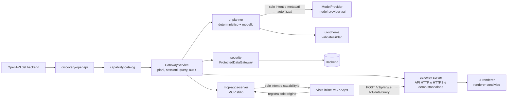

# Adaptive UI Gateway: stato dello sviluppo

**Data:** 1 novembre 2026 · **Branch:** `main` @ `54c7888` · **Spec di riferimento:** `adaptive-ui-gateway-architecture-spec-v0.3.md`

**Ultimo aggiornamento locale:** 4 novembre 2026. Correzioni successive a `54c7888` non ancora committate.

**Preparazione pubblica v0.1:** README e guide in inglese, licenza MIT, policy di sicurezza,
contributi e sei proposte di lavoro sono pronti. Uno snapshot separato, senza la cronologia
originale o configurazioni locali, è stato caricato in
[CELOTTOA/adaptive-ui-gateway](https://github.com/CELOTTOA/adaptive-ui-gateway).
La [prima CI reale](https://github.com/CELOTTOA/adaptive-ui-gateway/actions/runs/41847411105)
ha superato tutti i job Windows/Linux con Node 22/24, inclusi smoke demo e controlli di
pubblicazione. [Resoconto e limiti](../publication.md).

## In sintesi

AUG genera interfacce dichiarative a partire dalle capability di un backend esistente. Lo fa in
modalità **Protected**: il modello progetta l'interfaccia senza vedere i dati, che arrivano solo
alla vista attraverso un canale autorizzato separato dal protocollo MCP.

Ad oggi:

- Il **planner con modello AI** è operativo con un provider reale (xAI Grok) e resta sicuro anche
  quando il modello sbaglia o viene manipolato: in quei casi si passa al planner deterministico.
- Il commit `54c7888` sostituisce il trasporto dei record tramite `_meta` con un **canale HTTP
  diretto tra vista e gateway**. Il tool MCP dei dati è stato eliminato: non è soltanto nascosto
  al modello.
- Build e suite ordinaria: **79 test totali, 76 superati e 3 live saltati**, oltre a una CI
  pronta per GitHub. Il test opt-in del backend Archteathos è stato eseguito separatamente:
  **10/10 superati**, con HTTP reale e le 13 schede del repository esistente.
- **Secondo backend provato: Archteathos.** Un adattatore read-only specifico espone ricerca
  teatri e misure dichiarate, con fonte e quote mancanti preservate. Nessuna modifica al
  repository Archteathos o ai package core AUG. La demo standalone legge ora la capability
  dal catalogo. [Avvio e limiti della prova](../../examples/archteathos/README.md).
- **Il flusso diretto è riuscito dentro Claude Desktop il 3 novembre.** I log reali mostrano
  registrazione della nuova origine, preflight 204, piano Grok creato con 201 e query HTTP con
  200 e una riga di `tenant-a`. Resta da completare la verifica esplicita del contesto del
  modello e della visualizzazione dei valori; i vecchi test dell'architettura `_meta` restano storici.
- Sul secondo host, ChatGPT Desktop, la vista si apre e l'origine è registrata, ma la CSP
  dell'host filtra HTTP. HTTPS locale è implementato e testato soltanto in locale.
- **La scelta sul certificato è sospesa per discuterne con l'utente.** La chiave generata ha
  ereditato permessi troppo ampi dal workspace: il certificato corrente non va installato.
  Non sono stati modificati l'archivio attendibile Windows o il profilo AUG reale per HTTPS.
  OAuth remoto, deployment AWS e scritture restano rimandati.

## Situazione operativa al 4 novembre

| Ambito | Verificato | Ancora aperto |
|---|---|---|
| Claude Desktop | Registrazione origine, piano Grok 201 e query HTTP 200 con una riga autorizzata nei log reali | Controllo visivo dei valori e verifica esplicita di ciò che il modello può citare |
| ChatGPT Desktop, host Codex locale | Collegamento STDIO, apertura della vista, origine nativa riconosciuta, CORS autorizzato | Il fetch HTTP è bloccato dalla CSP della build 26.1027.6604.0 |
| Gateway HTTPS | Certificati verificati, CORS, autenticazione, piano/query e processo MCP reale nei test locali | Flusso HTTPS dentro la sandbox ChatGPT non ancora verificato |
| Certificato locale | Generato e ispezionato; rilevati ACL e proprietà non adeguati alla protezione della chiave | Discutere la soluzione; prima di qualsiasi fiducia servirebbero storage privato e una nuova chiave |
| Fiducia Windows e configurazione utente | Nessun certificato importato; nessuna attivazione HTTPS automatica | Nessuna azione autorizzata sul certificato corrente; decisione rinviata |
| Secondo backend: Archteathos | 13 schede reali via HTTP, piano validato, ricerca nome/codice, quote e fonte, accessi negati, esclusione valori da planner/audit | Adattatore specifico e collaudo locale; motore di fattibilità, provider reale e host MCP non provati con questo backend |

La prova ChatGPT riguarda il server MCP locale nel Codex host dell'app. L'installazione di un
plugin per le normali chat ChatGPT resta un percorso distinto e non è stata completata.

## Avanzamento rispetto alla roadmap (spec §11)

| Fase | Contenuto | Stato |
|---|---|---|
| 0–3 | Discovery OpenAPI, catalogo, schema UI, validazione, data gateway protetto | Completate (slice read-only) |
| 4 — AI generation | Astrazione provider, planner vincolato, fallback | Completata: provider Grok reale, fallback deterministico, timeout configurabile |
| 5 — Host integration | Adapter MCP Apps per almeno un client | Flusso diretto riuscito su Claude; controlli modello/vista aperti. Secondo host ChatGPT fermo alla CSP HTTP e alla decisione sul certificato |
| 6 — Open-source launch | Docs, licenza, CI, esempi, threat model | In corso: CI pronta ma non verificata su GitHub; mancano licenza e documentazione pubblica |
| Operazioni di scrittura | Action broker con conferma | Rimandate per scelta, finché i gate Protected non sono superati |

## Architettura attuale



Il processo MCP avvia anche il gateway dati su `http://127.0.0.1:<porta libera>`, con una porta
assegnata dal sistema per ogni istanza. Il supporto HTTPS opzionale legge certificato e chiave
da `AUG_GATEWAY_TLS_CERT` e `AUG_GATEWAY_TLS_KEY`; con entrambe usa `https://127.0.0.1:<porta libera>`.
La vista e la sua CSP ricevono l'origine effettiva. HTTPS non è attivo nel profilo reale ChatGPT.
La vista usa lo stesso renderer condiviso, incorporato nel bundle MCP Apps. L'API accetta soltanto origini
dichiarate in `allowedOrigins`; nella configurazione MCP queste provengono da `AUG_VIEW_ORIGINS`,
con valore predefinito `null`, e dalla registrazione puntuale delle viste Claude/ChatGPT, anche
con schema nativo `codex-sandbox://`, tramite il bridge MCP. La registrazione scambia solo
l'origine, non credenziali, piani o record.

| Componente | Ruolo |
|---|---|
| `packages/core` | Tipi condivisi: capability, principal, UI Plan, errori |
| `packages/discovery-openapi` | Importa le operazioni GET dall'OpenAPI, con classificazione e scope per campo |
| `packages/capability-catalog` | Catalogo isolato per tenant e scope |
| `packages/ui-schema` | Validazione rigorosa del UI Plan: schema più controlli su binding, campi e azioni |
| `packages/ui-planner` | Planner deterministico e planner con modello (`ModelProvider` indipendente dal vendor) |
| `packages/model-provider-xai` | Adapter Grok, separato dal core |
| `packages/security` | Gateway dati: credenziale del backend solo lato server, filtro dei campi, limiti |
| `packages/ui-renderer` | Renderer fisso unico, usa solo `textContent` |
| `apps/gateway-server` | `GatewayService` riusabile, API HTTP/HTTPS per il canale diretto e demo standalone con CSP restrittiva |
| `apps/mcp-apps-server` | Server MCP (stdio), gateway locale, registrazione origini e vista MCP Apps; flusso Claude riuscito, ChatGPT ancora in verifica |

## Cosa garantisce la modalità Protected oggi

**Il modello non vede i dati.** Riceve solo l'intent ripulito, titolo e descrizione con limiti
di lunghezza, l'elenco dei campi autorizzati e i componenti disponibili. Non riceve record, ID
interni, policy, token o lo schema grezzo dell'API.

**Il modello non decide i binding.** Propone solo un layout: colonne, etichette, testi. Data
source, capability e policy li assembla il gateway, e il risultato passa comunque da
`validateUiPlan`.

**Un output sbagliato o malevolo non apre falle.** Il gateway rifiuta:
- JSON non valido o risposte troppo grandi;
- campi non autorizzati;
- markup, URL o caratteri di controllo nei testi;
- campi aggiuntivi come `bindingPolicyId`.

In questi casi usa il planner deterministico, oppure, se configurato così, restituisce un
errore 503. Questo vale anche quando un prompt injection inserito nella descrizione OpenAPI
convince il modello.

**Accesso ai dati.** Ogni query verifica utente, tenant, sessione, azione e policy dei campi. Le
sessioni scadono, vengono rimosse e il loro numero è limitato. Le credenziali del backend restano
nel gateway; il token di accesso demo viene inserito nella vista e mantenuto soltanto in memoria.

**Dentro l'host (MCP Apps):**
- il modello vede `aug_list_capabilities` e `aug_create_search_view`; il tool app-only
  `aug_register_view_origin` registra esclusivamente l'origine della vista. `aug_query_records`
  non esiste più e non esiste un fallback MCP per leggere i record;
- l'apertura della vista restituisce metadati di richiesta e `structuredContent.view`, contenente
  solo `intent` e `capabilityId`; non usa `_meta` personalizzato per piano, sessione o record;
- la vista riceve la richiesta tramite `ontoolinput`, con fallback su `structuredContent.view`;
- la vista crea il piano con `POST /v1/plans` e legge i record con `POST /v1/data/query`, usando
  fetch diretto con `credentials: "omit"` e `cache: "no-store"`;
- il gateway gestisce preflight `OPTIONS`, CORS con exact-match e rifiuto delle origini non
  dichiarate; la CSP della risorsa limita le connessioni all'origine del gateway;
- il token di accesso e il `planId` non vengono inseriti nei risultati MCP.

Questa architettura tiene i record fuori dai messaggi MCP; non richiede anonimizzazione per la
vista protetta. Un'eventuale anonimizzazione per analisi autorizzate è un'opzione server-side
separata, non un sostituto del canale diretto.

**Confine del threat model.** Si assume un client desktop non compromesso. AUG non promette di
proteggere i dati da un host locale malevolo, da screenshot o da una loro divulgazione volontaria
da parte dell'utente. La conservazione dei metadati da parte dei servizi dell'host richiede una
verifica separata; il canale diretto evita di consegnare i record a quel percorso.

**Audit.** Si registrano creazione dei plan, query eseguite e query rifiutate. Gli eventi
contengono solo ID, nomi dei campi, conteggi e codici d'errore, mai valori.

## Evidenze di verifica

### Test automatici (`npm test`)

Ultima esecuzione sul working tree del 3 novembre: **75 superati, 2 live saltati, 0 falliti**. Anche
`npm run build` è riuscito.

| Area | Test | Cosa dimostrano |
|---|---|---|
| Contratto UI Plan | 5 | Componenti, azioni, campi e policy non ammessi vengono rifiutati |
| Planner con modello | 16 | Canale del modello senza canary e senza credenziali, resistenza a injection e output malevoli, fallback in caso di errore o timeout |
| Provider Grok e configurazione | 8 | Formato delle richieste, errori che non espongono chiave o corpo della risposta, validazione delle variabili d'ambiente |
| Renderer condiviso | 5 | Solo `textContent`, solo le colonne del plan, componenti sconosciuti ignorati |
| GatewayService e audit | 5 | Pulizia e limite delle sessioni, audit senza valori, robustezza del sistema di audit |
| Flusso Protected HTTP | 8 | Isolamento tra tenant, replay della sessione, origin, scope, CSP |
| Adapter MCP Apps | 7 | Assenza del tool dati, nessun piano o record in `_meta`, CSP, query diretta fuori da MCP, credenziali e sessioni falsificate rifiutate, preflight e registrazione esatta dell'origine |
| Registro origini vista | 5 | Origini esatte Claude/ChatGPT/Codex nativo e isolate per istanza, rifiuto di siti estranei e URL ingannevoli, limite di memoria |
| Connessione della vista | 7 | Diagnostica senza token, distinzione HTTP/rete, CSP, solo origine sul bridge anche per lo schema nativo Codex, arresto se la registrazione è rifiutata |
| Avvio stdio e TLS | 3 | Due processi reali, gateway distinti, CORS e isolamento, piano/query HTTPS, rifiuto di configurazioni TLS incomplete |
| Gateway HTTPS | 3 | Validazione del certificato, fiducia esplicita per richiesta nei test, CORS, autenticazione e same-origin HTTPS |
| Identità MCP | 3 | Utente da variabili d'ambiente con validazione |
| Live Grok (manuali) | 2 | Compatibilità reale con Grok; non rieseguiti dopo questa modifica, che non cambia il planner |

I nuovi test sulle origini HTTPS ChatGPT e sullo schema nativo Codex fallivano prima delle
rispettive correzioni. Per i controlli più critici già verificati (campi autorizzati, testo
sicuro, pulizia delle sessioni) la disattivazione del controllo aveva fatto fallire i test.
Separatamente dalla suite npm, il controllo dello script di fiducia, con importazione simulata,
ha confermato il rifiuto degli ACL attuali prima di qualsiasi importazione del certificato.

### Smoke test del nuovo canale diretto

Sul processo MCP reale, con planner deterministico, sono stati verificati:

- health del gateway: `{"status":"ok","mode":"protected"}`;
- creazione del piano tramite `POST /v1/plans`;
- query tramite `POST /v1/data/query`, con piano `aug.ui/0.1` e una riga restituita direttamente.

Lo smoke test verifica i processi e gli endpoint reali, ma **non** la sandbox di Claude Desktop.

### Verifica su host reale (Claude Desktop, Windows)

Le precedenti prove sul commit `448fad3` riguardano l'architettura basata su `_meta`. Avevano
verificato apertura della vista, ricerca `CANARY`, assenza dei valori nel modello e impossibilità
di chiamare il tool dati. Non vengono riportate come verifiche della versione corrente.

Il precedente esito secondo cui Claude Desktop inoltrava il `_meta` personalizzato alla vista è
**superato**: nel caso osservato il risultato conteneva `content`, `structuredContent` e `isError`,
ma nessuna chiave `_meta`, `planId` o `plan`. Questo ha motivato la rimozione del trasporto dati
tramite `_meta`, senza spostare i record in `content` o `structuredContent`, visibili al modello.

| Verifica del working tree del 3 novembre | Esito |
|---|---|
| Ricezione della richiesta tramite `ontoolinput` o fallback `structuredContent.view` | Percorso riuscito: la vista ha proseguito fino a piano e query; callback specifico non distinto dai log |
| Creazione del piano dalla vista con token inserito dall'utente | Riuscita: POST /v1/plans 201, planner Grok, circa 1,2 s |
| Query con una sola riga di `tenant-a` | Riuscita: POST /v1/data/query 200, audit rowCount 1; filtro e valori non registrati |
| Accesso della sandbox al gateway HTTP loopback e CORS | Riuscito nell'esecuzione osservata, preflight 204 per piano e query |
| Assenza dei record e del token nel canale visibile al modello | Coperta dai test locali; nessun canary o token nel log AUG della sessione; verifica esplicita del contesto modello ancora da eseguire |

Il documento `docs/spikes/mcp-apps-claude-desktop.md` distingue ora il flusso diretto corrente
dal precedente trasporto `_meta` e riporta l'evidenza reale del 3 novembre.

## Rischi aperti e debito tecnico

| Tema | Impatto | Azione proposta |
|---|---|---|
| Sandbox Claude Desktop | Il flusso attuale funziona su questo host; policy e comportamento possono variare con host e versioni | Registrazione esatta dell'origine implementata; mantenere verifica reale dopo aggiornamenti dell'host |
| CSP ChatGPT Desktop | La build osservata elimina gli endpoint HTTP dalla CSP, impedendo il canale diretto anche dopo la correzione CORS | HTTPS è pronto nei test; decidere prima come gestire il certificato, poi verificare la sandbox reale |
| Chiave del certificato locale | Gli ACL ereditati consentono lettura ad altri utenti e modifica ad Authenticated Users; esclusione Git insufficiente | Certificato corrente da non installare; discutere storage privato, rigenerazione e validità breve |
| Fiducia del certificato Windows | La fiducia dell'utente vale per le applicazioni che usano quell'archivio, non soltanto per AUG | Nessuna importazione effettuata; riesaminare rischio, ciclo di vita e rimozione prima di una nuova proposta |
| Identità demo | Il token condiviso non è adatto a dati reali o più utenti | Mantenerlo solo nello spike locale; progettare OAuth per il server remoto in una fase successiva |
| Conservazione dei metadati lato host | Intent, titoli ed etichette seguono un percorso diverso dai record e non sono verificabili interamente in locale | Verifica documentale o contrattuale prima di usare metadati sensibili |
| Disclosure avviata dall'utente | L'utente può incollare righe o screenshot nella conversazione | Avviso esplicito nella UI della vista |
| Secondo host non completato | La portabilità del canale protetto non è ancora dimostrata su ChatGPT | Completare lo spike già avviato dopo la decisione sul trasporto e sul certificato |
| Testi visibili al modello | Titolo ed etichette possono riflettere un'injection nell'OpenAPI | Già filtrati da `isSafeText` e limiti di lunghezza; valutare una lista di vocaboli ammessi |
| Destinazione dell'audit | Oggi gli eventi vanno su stdout/stderr | Scegliere un sistema di produzione, con conservazione dei dati e controllo accessi |
| CI non verificata su GitHub | La configurazione locale non dimostra l'esito del workflow remoto | Primo push e verifica del workflow |
| Licenza e documentazione pubblica | Necessarie per la Fase 6 | Completare prima della pubblicazione |
| Planner che usa poco l'intent | Con 5 componenti il valore della UI generata è limitato | Ampliare il catalogo dei componenti solo dopo i gate |

## Prossimi passi consigliati

1. **Discutere la soluzione del certificato.** Nessuna importazione, rigenerazione o modifica
   alla fiducia Windows è da eseguire in questa fase. Se si sceglierà HTTPS locale, occorrerà
   prima proteggere lo storage e generare una chiave nuova, con validità breve e nuova impronta
   da riesaminare; il certificato corrente non è un candidato da approvare.
2. **Solo dopo la decisione, completare lo spike ChatGPT.** Applicare la soluzione scelta e
   verificare nella sandbox reale preflight, piano e query, senza usare il successo dei test
   locali come prova dell'host.
3. **Completare i controlli sul confine modello/vista su Claude.** Il canale diretto è già riuscito sull'host;
   verificare visivamente i valori della ricerca `CANARY` e con una domanda esplicita che il
   modello non possa citarli. Questi passaggi non sono dimostrati dal solo audit delle query.
4. **Verificare una seconda conversazione sullo stesso host.** La registrazione delle origini
   è coperta dai test; un ulteriore cambio reale di origine confermerà la regressione sull'host.
5. **Completare le evidenze degli spike** prima di procedere con pubblicazione open source,
   OAuth remoto o deployment AWS.
6. **Solo dopo i gate Protected:** operazioni di scrittura con action broker, conferma esplicita e
   idempotenza, come da spec.

## Cronologia

| Commit | Contenuto |
|---|---|
| `1832d22` | Slice protetta read-only iniziale |
| `35e40b7` | `.envlocal` escluso da git |
| `29e812e` | Planner con modello e fallback deterministico |
| `13119b8` | Provider Grok e timeout configurabile |
| `3894298` | Estrazione di `GatewayService` |
| `2be422e` | Primo spike MCP Apps su Claude Desktop |
| `875f579` | Audit, renderer condiviso, identità MCP configurabile |
| `448fad3` | CI GitHub Actions |
| `54c7888` | Canale dati diretto per le viste MCP, senza record o sessioni in `_meta` |

## Come riprodurre

```bash
npm ci
npm test              # 75 test locali + 2 live saltati senza chiave
npm run test:live     # richiede GROK_API_KEY in .envlocal
npm run demo          # demo standalone su http://127.0.0.1:4000 (token: demo-analyst-token)
```

Per Claude Desktop: `npm run build`, voce `aug` in `claude_desktop_config.json` e riavvio
completo di Claude Desktop. Il processo MCP avvia il gateway diretto su una porta libera per
istanza; la demo standalone continua a usare la porta 4000. `AUG_VIEW_ORIGINS` accetta una lista di
origini separate da virgole e usa `null` come valore predefinito.

## Correzione avvio multi-istanza — 2 novembre 2026

Le sezioni successive conservano la cronologia delle prove. Le istruzioni e le ipotesi
superate non sostituiscono la situazione operativa e i prossimi passi riportati sopra.

I log reali di Claude Desktop mostrano un'istanza AUG inizializzata e successive istanze per
Cowork e Code terminate con `EADDRINUSE` su `127.0.0.1:4000`. Il gateway MCP ora richiede una
porta libera al sistema e incorpora l'origine assegnata nel bundle della vista e nella CSP.

Un nuovo test avvia due processi MCP reali contemporaneamente, verifica handshake, disponibilità
del tool, origini distinte, configurazione della vista e health di entrambi i gateway. Il test
falliva prima della correzione con lo stesso `EADDRINUSE` osservato nell'host. Dopo la correzione:
`npm test` riuscito, **57 superati, 2 live saltati, 0 falliti** (59 totali), build inclusa.
Alle 11:17 del 2 novembre, il log reale `mcp-server-aug.log` conferma l'avvio corretto del
gateway su `http://127.0.0.1:53824` e l'inizializzazione del client `local-agent-mode-aug`.
La verifica della vista dentro la sandbox rimane separata dalla correzione dell'avvio.

### Vista aperta, richiesta diretta fallita — 2 novembre 2026

Lo screenshot delle 11:32 conferma che Claude renderizza la vista e il form, ma la creazione
dell'interfaccia termina con `Failed to fetch`. Non dimostra ancora se il blocco sia CORS,
CSP o accesso alla rete locale. I gateway attivi sulle porte 4000 (istanza precedente) e 53824
rispondono entrambi a `/health` e al preflight per l'origine `null`.

Sono stati aggiunti dettagli di connessione visibili solo in caso di errore: origine della
vista, origine del gateway, contesto sicuro, policy di rete riconosciute dal browser ed eventuale
violazione `connect-src`. Il processo MCP registra per le richieste API soltanto metodo,
percorso fisso, origine e stato HTTP; nessun token o corpo. Tre test verificano distinzione fra
errore HTTP e di rete e assenza di token o parametri URL nei dettagli. Suite: **60 superati,
2 live saltati, 0 falliti** (62 totali). La causa nella sandbox resta da identificare: occorre
riavviare completamente l'host, aprire una nuova vista e leggere i dettagli del nuovo errore.

### Origine effettiva Claude e correzione CORS — 2 novembre 2026

La vista riporta origine `https://6ccaa9c11ae653932af7f2a4f8a398aa.claudemcpcontent.com`,
contesto sicuro e policy `local-network` / `loopback-network` non delegate dall'host. Tuttavia
il log reale contiene un `OPTIONS /v1/plans` con quell'origine e stato **403**: il preflight
raggiunge il gateway e viene rifiutato dalla configurazione CORS che ammetteva solo `null`.
La policy riportata dalla vista non basta quindi a stabilire la causa esclusiva dell'errore.

L'origine esatta osservata è stata aggiunta a `AUG_VIEW_ORIGINS` nel file locale `.envlocal`
(escluso da Git), senza wildcard. Il test di avvio dei processi MCP verifica ora anche che
l'origine configurata sia ammessa al preflight e un'origine estranea rimanga rifiutata.
Suite completa: **60 superati, 2 live saltati, 0 falliti** (62 totali).

Smoke test con un processo MCP reale che carica `.envlocal`, planner deterministico e origine
Claude osservata: preflight **204**, creazione piano **201**, query **200** con una sola riga
autorizzata; origine estranea **403**. Questo verifica configurazione e API, non la sandbox.

La configurazione viene letta all'avvio: le istanze Claude già attive richiedono un riavvio
completo. Dopo il riavvio occorre verificare una nuova vista, prima di concludere che anche la
policy di rete dell'host impedisca il collegamento. L'SDK installato dichiara soltanto permessi
camera, microfono, geolocalizzazione e clipboard; non espone un permesso standard per la rete
locale da richiedere tramite `ui.permissions`.

### Origini per conversazione e registrazione tramite bridge — 3 novembre 2026

Dopo il riavvio, la vista usa `https://c97ed9f1b75922fa9343c6c829470c45.claudemcpcontent.com`,
diversa da quella precedente. Il log conferma il nuovo preflight con **403**. La correzione che
aggiungeva manualmente un solo dominio non risolve le nuove conversazioni e viene superata.

La [documentazione Claude](https://claude.com/docs/connectors/building/mcp-apps/troubleshooting#uidomain-validation-fails)
specifica che `ui.domain` stabile non è disponibile per i connettori locali stdio. Ora, prima
del primo fetch, la vista registra `window.origin` con `aug_register_view_origin`, tool app-only
che non restituisce dati. Il server ammette soltanto origini HTTPS nel formato esatto
`<32 caratteri esadecimali>.claudemcpcontent.com`, aggiunge l'origine puntuale all'allowlist della
sola istanza corrente e limita le registrazioni dinamiche a 128, fino alla chiusura del processo.
Le vecchie origini aggiunte manualmente sono state rimosse da `.envlocal`.

**Confine di fiducia:** la registrazione usa la connessione MCP locale e non dimostra da sola
l'identità della vista; la visibilità app-only non è autenticazione. Non concede accesso ai
record: credenziale HTTP, utente, tenant, sessione e policy restano obbligatori per ogni query.
Il bridge riceve soltanto `{ origin }`; token, piani e record continuano a usare il canale HTTP.
Nessuna wildcard CORS, nessun inoltro dei dati via MCP e nessuna modifica alle policy di Claude.

`npm test`: **66 superati, 2 live saltati, 0 falliti** (68 totali), build inclusa. Il test con
due processi MCP reali verifica preflight 403 prima della registrazione, 204 dopo, 403 nell'altra
istanza, piano 201 e query 200 con una sola riga. I test della vista verificano che il bridge
riceva solo l'origine e che un rifiuto interrompa il fetch. **La verifica su Claude della nuova
registrazione era inizialmente pendente**; l'esecuzione riportata sotto ne verifica il flusso reale.

### Flusso diretto riuscito su Claude Desktop — 3 novembre 2026, 08:28 CET

Nel log reale `%LOCALAPPDATA%\Claude\Logs\mcp-server-aug.log`, sessione avviata alle
08:27:50 CET, il client `claude-ai` inizializza AUG e legge la risorsa della vista. Il gateway
dell'istanza è `http://127.0.0.1:51009`; l'origine della vista è una nuova origine mai aggiunta
manualmente: `https://3321176280071b5922172a5004629362.claudemcpcontent.com`.

| Ora CET | Evidenza osservata |
|---|---|
| 08:28:25 | Chiamata tools/call della vista seguita da preflight /v1/plans 204 |
| 08:28:26 | Planner Grok reale, source model, durata 1232 ms; audit plan.created per tenant-a; POST /v1/plans 201 |
| 08:28:42 | Preflight /v1/data/query 204; audit query.executed con rowCount 1 e soli campi autorizzati; POST /v1/data/query 200 |

La scansione del solo log AUG a partire dall'avvio di questa sessione trova **0 canary dei
record e 0 occorrenze dei token demo**; non ci sono preflight 403 nella sessione. Questo prova
che la sandbox ha completato piano e query sul canale diretto nonostante i precedenti report
di policy non delegate. La verifica è basata sui log reali, non su un client HTTP esterno.

I log non contengono filtro o valori dei record, quindi non dimostrano da soli che la query
fosse `CANARY`, quali valori siano stati visualizzati o cosa il modello possa citarne. Non
sono state inviate nuove domande a Claude per verificare il suo contesto. Questi controlli e
la conservazione lato host restano evidenze separate dal successo del canale diretto.

### Preparazione secondo host: ChatGPT Desktop — 3 novembre 2026

È stata aggiunta la registrazione delle origini sandbox ChatGPT documentate, mantenendo le
origini esatte per istanza. Vista e server usano lo stesso pattern; i due tool di metadati
espongono annotazioni read-only, mentre il registrar dichiara la modifica allo stato in memoria.
I test nuovi fallivano prima della modifica. `npm test`: **68 superati, 2 live saltati** (70 totali).
Il test STDIO con processi reali ora copre registrazione, piano e query con un'origine ChatGPT.

La [procedura locale](../spikes/mcp-apps-chatgpt-desktop.md) e il relativo TOML sono pronti.
La configurazione locale riguarda il Codex host di ChatGPT Desktop; l'uso nelle normali chat
tramite plugin è un percorso distinto. **ChatGPT reale non è ancora verificato**, in particolare
rendering della vista e accesso diretto al loopback. Non sono stati modificati config utente,
pubblicati server o attivati tunnel.

### Schema nativo Codex osservato e supportato — 3 novembre 2026

La vista reale ha raggiunto il form e riportato l'origine
`codex-sandbox://mcp-app-759ffd0cc15e6b093ffcc9e0beb80edc046100e46aa928f0.web-sandbox.oaiusercontent.com`,
con contesto sicuro e policy locali delegate. Il matcher precedente, limitato a HTTPS, non
registrava questa origine. Una riproduzione HTTP contro il gateway attivo sulla porta 62522
con tale Origin restituisce 403; non è una cattura dell'intestazione inviata dal browser.

Il pattern condiviso tra vista e server ora riconosce anche questo formato nativo, con schema
esatto e ID di 48 caratteri esadecimali. L'origine viene registrata integralmente; il CORS
rimane puntuale, senza conversione a HTTPS né wildcard. Due test nativi fallivano prima della
correzione. Suite completa: **70 superati, 2 live saltati, 0 falliti** (72 totali), build inclusa.
Il test con due processi MCP verifica isolamento, preflight 204 con allow-origin esatto, piano
201 e query 200 per origini sia HTTPS sia native. **Resta il nuovo test dentro l'app** dopo
aver ricaricato il server AUG e aperto una vista nuova.

### CSP host confermata e HTTPS locale preparato — 3 novembre 2026, 17:37 CET

Il gateway reale sulla porta 50215 autorizza già l'origine nativa (preflight esterno 204).
I log di ChatGPT Desktop mostrano invece un rifiuto `connect-src` del fetch HTTP prima che
possa raggiungere il gateway. L'ispezione in sola lettura della build `26.1027.6604.0` conferma
che il normalizzatore della risorsa filtra HTTP ma conserva HTTPS, sia per i metadati standard
sia per l'alias OpenAI. Non sono stati modificati file dell'applicazione o le sue policy.

È pronto HTTPS opzionale nel gateway e nel processo MCP, con certificato/chiave letti dalle
variabili `AUG_GATEWAY_TLS_CERT` e `AUG_GATEWAY_TLS_KEY`. Senza entrambe resta HTTP; con una
sola variabile l'avvio fallisce. Origine della vista e CSP ricevono l'indirizzo HTTPS effettivo;
il same-origin viene verificato usando lo schema del socket reale.

Suite completa: **75 superati, 2 live saltati, 0 falliti** (77 totali). I cinque nuovi test
coprono certificato non attendibile rifiutato, fiducia esplicita per singola richiesta di test,
CORS e query protette su HTTPS, same-origin HTTPS, processo MCP reale TLS e configurazione
incompleta. I certificati fixture dei test sono separati da quello locale e non vengono
installati in Windows. Non è stato disabilitato alcun controllo TLS.

Il certificato locale generato, non CA, è emesso solo per localhost/127.0.0.1 e scade il
3 novembre 2027. Chiave e certificato locali sono esclusi da Git in `.local/tls/`. Lo script
di fiducia verifica l'impronta SHA-256 prima di importare il solo certificato pubblico in
`Cert:\CurrentUser\Root`. Questa proposta iniziale è stata **sospesa dal successivo riesame ACL**;
il certificato corrente non va installato. La configurazione reale dell'utente non è stata modificata. Dettagli e impronte
sono nella [procedura ChatGPT](../spikes/mcp-apps-chatgpt-desktop.md).

### Riesame sicurezza del certificato locale — 3 novembre 2026

Il controllo ACL della chiave generata ha rilevato lettura per `BUILTIN\Users` e modifica per
`NT AUTHORITY\Authenticated Users`, ereditate dal workspace. La chiave non va considerata
protetta dalla sola esclusione Git. **La proposta di fiducia del certificato corrente è
sospesa**: prima servono storage privato e una nuova coppia di chiavi a validità breve.
Lo script di importazione ora rifiuta permessi estesi o proprietà inattesa di chiave/cartella.
Nessun certificato è stato importato nell'archivio attendibile dell'utente reale.

Su richiesta dell'utente, viene aggiornato lo stato e **rinviata la discussione sulla soluzione
del certificato**. Non sono state eseguite ulteriori operazioni sui certificati, sugli ACL o
sulla configurazione reale. La proposta precedente non costituisce approvazione dell'installazione.
